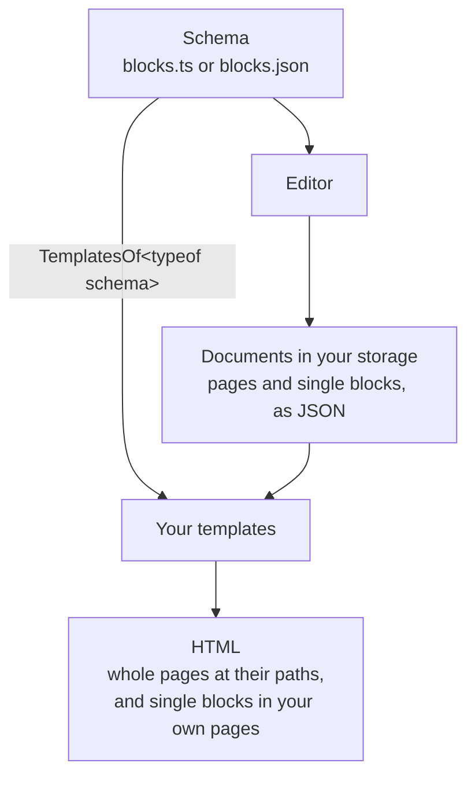

# loomhelix-cms

A visual page editor for a site that you code. You declare the blocks of the site in a schema. Your client builds
pages, or edits single blocks, and sees the result in a preview. The content is JSON in your storage, and your
templates turn it into HTML.

Status: in development. The packages are not on npm yet.

## How it works



You write three things:

1. The schema: the block types of the site and the fields of each type. Write it in `blocks.ts`, or give a
   `blocks.json` from any source, for example a different service. Each part reads both.
2. A template for each type. `TemplatesOf<typeof schema>` gives the types of the templates, so TypeScript reports a
   template that reads a field that the schema does not have.
3. The storage of the documents. The editor calls your `read` and `write` functions, and your site keeps the
   documents where it wants. On Node.js, the optional adapter `createCms` gives a folder storage, the editor page,
   the preview, and the pages in one handler.

| loomhelix-cms gives                                                     | Your site does                                     |
| ----------------------------------------------------------------------- | -------------------------------------------------- |
| The format of the schema and the documents, with the shared tests       | Keeps the documents: files, a database, a service  |
| Validation and migrations (`@loomhelix-cms/schema`)                     | Checks who can edit, with its own login            |
| The HTML renderer and the template types (`@loomhelix-cms/render-html`) | Gives the editor `read`, `write`, and `list`       |
| The editor and the preview bridge                                       | Renders the preview and the pages at its addresses |
| The command `lhcms`                                                     | Decides where the single blocks show               |
| Optional adapters: `createCms` for Node.js and `createHttpStorage`      |                                                    |

The schema also gives these parts:

| Part       | What it does with the schema                                                                      |
| ---------- | ------------------------------------------------------------------------------------------------- |
| Validation | Checks each page against the schema. Each error names the block and tells what is wrong.          |
| Migrations | Updates old content when a block type changes. A migration is data, so each backend can apply it. |
| Renderer   | Renders the page with your templates. It escapes each value and rejects unsafe links.             |
| Editor     | Makes a form for each block type and shows your client the real page in a preview.                |

The content contains no HTML and no CSS classes. When you change the design of the site, you change the templates
only.

## Add it to a Node.js site

The packages are not on npm yet, so add your site as a folder of this repository.

1. Install the dependencies and build the packages: `pnpm install` and `pnpm build`.
2. Make the folder `apps/my-site` with this `package.json`. Then run `pnpm install` again.

   ```json
   {
     "name": "my-site",
     "private": true,
     "type": "module",
     "dependencies": {
       "@loomhelix-cms/node": "workspace:*",
       "@loomhelix-cms/render-html": "workspace:*",
       "@loomhelix-cms/schema": "workspace:*"
     },
     "devDependencies": {
       "@loomhelix-cms/cli": "workspace:*",
       "@types/node": "catalog:"
     }
   }
   ```

3. Write `tsconfig.json`. With it, TypeScript checks the templates against the schema.

   ```json
   {
     "compilerOptions": {
       "module": "nodenext",
       "target": "esnext",
       "types": ["node"],
       "strict": true,
       "noEmit": true,
       "allowImportingTsExtensions": true
     }
   }
   ```

4. In this folder, write the schema in `blocks.ts`:

   ```ts
   import { block, defineSchema, image, page, slot, text } from '@loomhelix-cms/schema';

   export default defineSchema({
     pages: {
       Landing: page({
         label: 'Landing page',
         slots: { main: slot(['Hero'], { label: 'Sections' }) },
       }),
     },
     blocks: {
       Hero: block({
         label: 'Hero',
         fields: {
           title: text({ label: 'Title', maxLength: 80 }),
           image: image({ label: 'Image', optional: true }),
         },
       }),
     },
   });
   ```

5. Write `templates.ts`. To get a first template for a type, run `pnpm exec lhcms template Hero`.

   ```ts
   import { html, type TemplatesOf } from '@loomhelix-cms/render-html';
   import type schema from './blocks.ts';

   export const templates = {
     Landing: ({ props, slots }) =>
       html`<!doctype html>
         <html lang="en">
           <head>
             <meta charset="utf-8" />
             <title>${props.title}</title>
           </head>
           <body>
             ${slots.main}
           </body>
         </html>`,
     Hero: ({ props }) =>
       html`<section class="hero">
         <h1>${props.title}</h1>
         ${props.image === undefined ? '' : html``}
       </section>`,
   } satisfies TemplatesOf<typeof schema>;
   ```

6. Make the folder `pages`, and write `server.ts`:

   ```ts
   import { createServer } from 'node:http';
   import { createCms, createFolderStore } from '@loomhelix-cms/node';
   import { templates } from './templates.ts';

   const cms = await createCms({
     schemaFile: 'blocks.ts',
     templates,
     store: createFolderStore('pages'),
     canEdit: (request) => request.headers.host === 'localhost:3000',
   });

   createServer(cms.handle).listen(3000, '127.0.0.1');
   ```

7. Start the server: `node server.ts`. Node.js 22.18 and later run TypeScript files without a build.
8. Open `http://localhost:3000/cms`, and select "New page". Type a title, change the address to `/`, and select
   "Create page".
9. Open `http://localhost:3000/` to see the page.

`canEdit` decides who can use the editor. In this example, only the local host name gets access, and the server
listens only on 127.0.0.1. On a real site, check the session of your login in `canEdit`.

- `cms.handle` has the form `(request, response, next)`. In Express, add `app.use(cms.handle)` after your own routes.
- The default store keeps each document in a JSON file. For a database, give an object with `list()`, `read(id)`,
  and `write(id, text)`. `createCms` keeps the paths of the pages in memory for 5 seconds, and a save updates them. A change that a different
  program makes shows on the site within 5 seconds.
- For a `record` field, give `createCms` the option `records` with two functions for each source:
  `records: { products: { lookup: (query) => findProducts(query), read: (ids) => productsWithIds(ids) } }`. The
  editor searches with `lookup` (section 8 of [the spec](docs/spec-v0.md)), and the templates get the records of
  `read`. `createCms` does not start if a source of the schema has no `lookup` or no `read`.
- To accept image uploads, give `createCms` the option `uploads: createFolderUploads('uploads', '/uploads')`. It
  keeps each image in the folder under a random name and serves it at `/uploads`, with an ETag. It accepts PNG, JPEG, WebP, GIF,
  and AVIF files up to 10 MB, and it finds the type from the content of the file. For a different storage, give an
  object with `save(image)`: keep `image.bytes`, and give the address of the image.
- A program in a different language needs JSON: `pnpm exec lhcms build` writes `blocks.json` from `blocks.ts`.
- With a `blocks.json` from a different source, use `schemaFile: 'blocks.json'`. Then `pnpm exec lhcms types` writes
  the types of the templates to `blocks.types.ts`.
- To connect the editor to a backend in a different language, see [Editor](#editor).

## Edit one block

A block document is one block without a page, for example the opening hours, a footer, or a banner on a product
page. Each block type of the schema can be a block document. The site decides where the block shows.

1. Put the editor on any page of your admin area. Give it the id of the document and its block type:

   ```html
   <script type="module" src="/cms/editor.js"></script>
   <script type="module" src="/cms/storage.js"></script>
   <lhcms-editor
     document-id="opening-hours"
     document-type="Notice"
     schema-url="/cms/blocks.json"
     preview-url="/cms/preview"
   ></lhcms-editor>
   ```

   The editor opens this document only, without the page list. If the document does not exist, the first save
   creates it. The script `/cms/storage.js` of `createCms` gives each editor of the page the storage of `createCms`.
   With your own storage, set `editor.storage` instead.

2. Put the block into a page of your site. `renderBlock` gives the HTML of the block, or `undefined` if the block
   does not exist yet:

   ```ts
   const openingHours = (await cms.renderBlock('opening-hours')) ?? '';
   ```

3. Give the preview the styles of your site with the option `blockPreviewPage` of `createCms`:

   ```ts
   blockPreviewPage: (blockHtml) =>
     `<!doctype html><html><head><link rel="stylesheet" href="/site.css" /></head><body>${blockHtml}</body></html>`,
   ```

## The schema

This schema has one page type and one block type. The block type `Hero` has version 2, because version 1 had the
field `heading` instead of `title`.

```json
{
  "formatVersion": 0,
  "pages": {
    "Landing": {
      "version": 1,
      "slots": { "main": { "allow": ["Hero"] } }
    }
  },
  "blocks": {
    "Hero": {
      "version": 2,
      "fields": {
        "title": { "type": "text", "label": "Title", "maxLength": 80 },
        "image": { "type": "image", "label": "Image", "optional": true }
      },
      "migrations": [
        { "from": 1, "operations": [{ "op": "renameField", "from": "heading", "to": "title" }] }
      ]
    }
  }
}
```

- A block type has fields and slots. The field types are `text`, `richText`, `link`, `image`, `choice`, `number`,
  `boolean`, and `record`.
- An option of a `choice` field is a name, or a name with a label for the editor:
  `{ "name": "dark", "label": "Dark background" }`. The block stores the name.
- An `image` value is `{ src, alt }`, and it can also have `width` and `height` in pixels. When the client changes
  the address, the editor measures the image. Put the size into the `img` element, so that the page does not move
  when the image loads.
- A `record` field selects a record from the data of your site, for example a product:
  `{ "type": "record", "source": "products" }`. The block stores the id of the record.
- A slot contains other blocks. Its `allow` list gives the block types that it accepts, and the optional `min` and
  `max` give the number of blocks.
- A page type is the type of the root block of a page. Each page also has a title, a description, and a path.
- When you change a block type, increase its `version` and add a migration.
- To rename a type, change its key, and add the earlier name to `oldNames`. A block with the earlier name loads as
  this type. Then `lhcms migrate` writes the new name to the stored documents.
- To remove a type, remove it from the schema, and add its name to `removedTypes`. The load removes the blocks of
  this type from their slots.

[docs/spec-v0.md](docs/spec-v0.md) gives the full format.

## Validation and migrations

```js
import { loadDocument, parseSchema } from '@loomhelix-cms/schema';

const schema = parseSchema(JSON.parse(schemaText));
const { document, errors } = loadDocument(schema, JSON.parse(pageText));
```

`loadDocument` applies the migrations. A block that you saved with version 1 of `Hero` comes back at version 2:

```json
{ "id": "hero", "type": "Hero", "version": 1, "props": { "heading": "Fresh coffee" } }
```

```json
{ "id": "hero", "type": "Hero", "version": 2, "props": { "title": "Fresh coffee" } }
```

A block that does not follow the schema gets an error. The block stays in the document, so a save does not lose it:

```json
{
  "blockId": "promo",
  "code": "invalidProps",
  "message": "The block \"promo\" has a field \"title\" that must have no more than 80 Unicode code points, got 90."
}
```

The migration operations are `renameField`, `addField`, `removeField`, `mapValues`, `renameSlot`, and `removeSlot`.
They are data, not functions, so a backend in PHP, Python, or Go can apply them. The shared test cases in
`spec/test-cases` check each implementation of the format.

### Check and migrate the stored content

The editor and the renderer apply the migrations each time that they load a document. The `lhcms` command writes
the result back, and finds invalid blocks before a release. It reads a folder of JSON documents, for example the
folder of `createFolderStore`:

```sh
pnpm exec lhcms check pages
pnpm exec lhcms migrate pages
```

- `check` changes no file. It prints the errors of the blocks and the documents that the migrations change. If a
  document has an error, the command ends with the exit code 1.
- A block reference must show a document of the folder: the file name without `.json` is the id of the document.
- `migrate` writes each document that the migrations change. An invalid block stays without changes.

After you change the schema, compare it with the version that wrote the stored content. The earlier file can be JSON
or TypeScript:

```sh
git show HEAD:blocks.json > blocks.old.json
pnpm exec lhcms diff blocks.old.json
```

`lhcms diff` prints each change that makes stored blocks invalid, for example a removed field without a
`removeField` operation. For each change, it gives the migration operation that prevents it. If it finds an error,
the command ends with the exit code 1. A warning names a stricter rule, for example a smaller `maxLength`. Then
`lhcms check` finds the stored blocks that break it.

For documents in a database, load each document in a script, and save the result. In this example, `db` is your
own code:

```js
import { loadDocument, parseSchema } from '@loomhelix-cms/schema';

const schema = parseSchema(JSON.parse(schemaText));
for (const row of await db.readDocuments()) {
  const { document } = loadDocument(schema, JSON.parse(row.json));
  await db.writeDocument(row.id, JSON.stringify(document));
}
```

`loadDocument` throws a `DocumentError` for a document that does not follow the format. It keeps each invalid block
without changes, so the save does not lose content.

## HTML

```js
import { createRenderer, html } from '@loomhelix-cms/render-html';
import { loadDocumentSet } from '@loomhelix-cms/schema';

const render = createRenderer(schema, {
  Landing: ({ slots }) => html`<main>${slots.main}</main>`,
  Hero: ({ props }) => html`<section class="hero"><h1>${props.title}</h1></section>`,
});

const documents = await loadDocumentSet(schema, JSON.parse(pageText), readDocument);
const page = render(documents, 'live');
```

- `createRenderer` fails when a type of the schema has no template, or when a template has no type.
- `loadDocumentSet` loads the page and the block documents that its block references show. As a result, old
  content renders with the new templates.
- `readDocument(id)` is your own function. It gives the JSON of a document from your storage, or `undefined`.
- For `record` fields, call `loadRecords(schema, documents, readers)` before `render`. `readers` has a function for
  each source, for example `{ products: (ids) => db.productsWithIds(ids) }`. The template then gets the record, not
  the id. A required field without a record makes its block invalid.
- `TemplatesOf<typeof schema, { products: Product }>` gives a `record` field of the source `products` the type
  `Product`. Without it, a record has the type `SiteRecord`: an `id` and other properties of unknown types.
- `html` escapes each value. It rejects a value in a `<script>` element or in an event attribute such as `onclick`.
  It also rejects an unsafe link such as `javascript:alert(1)`.
- The live site does not show a block that has an error. The preview shows a message for the developer instead.

## Editor

On Node.js, `createCms` serves the editor at `/cms`. With a backend in a different language, add the element to a
page of your admin area. Give it a storage (section 8 of [the spec](docs/spec-v0.md)) and the preview of section 9.

```html
<script type="module" src="/lhcms/editor.js"></script>
<lhcms-editor schema-url="/blocks.json" preview-url="/preview"></lhcms-editor>
```

```js
const editor = document.querySelector('lhcms-editor');
editor.storage = {
  read: (id) =>
    fetch(`/my-api/${id}`).then((response) => (response.ok ? response.json() : undefined)),
  write: async (id, document) => {
    const response = await fetch(`/my-api/${id}`, {
      method: 'PUT',
      body: JSON.stringify(document),
    });
    if (!response.ok) {
      throw new Error(`The server did not save the document: ${response.status}.`);
    }
  },
  list: () => fetch('/my-api').then((response) => response.json()),
};
```

- The editor reads the schema from `schema-url`. It makes a form for each block type from the labels and the limits
  of its fields.
- When `schema-url` changes, the editor reads the schema again and applies the migrations to the open page. The
  unsaved changes stay.
- In each slot, the client can add only the block types that the slot allows.
- The block tree shows the errors of the block references. To find them, the editor reads the shown documents with
  `storage.read`.
- Under a slot, the list "Shared blocks" shows the block documents of the types that the slot allows. The editor gets
  them from `storage.list`. A click adds a block reference to the document. The editor does not add a reference that
  makes a loop.
- To change a shared block, select the block reference in the tree or in the preview, and then select "Edit the
  shared block". The editor opens the block document, and "← Back" opens the page again.
- To upload images, give the storage the function `upload(file)`. It keeps the file and gives `{ src }`, the address
  of the image. The editor then shows "Upload an image" next to the address of each image field, and it measures the
  uploaded image. `upload` rejects with an `Error` to refuse a file, and the editor shows its message.
- For a `record` field, give the storage the function `lookup(source, query)`. The editor shows a search, and the
  client selects a record by its name. `lookup(source, { text })` gives the records that match the text, and
  `lookup(source, { ids })` gives the records with these ids. Each record is `{ id, label }`. Without `lookup`, the
  client types the id.
- With `document-id` and `document-type`, the editor opens one document without the page list. See
  [Edit one block](#edit-one-block).
- The editor does not keep documents. Give it `editor.storage = { read, write, list }`, and keep the documents
  where you want. `read(id)` gives a document, `write(id, document, { isNew })` keeps it, and the optional `list()`
  gives the page list. `write` rejects with an `Error` to refuse a save, and the editor shows its message.
- The function `createHttpStorage(apiUrl)` of the editor package is an optional storage for the HTTP endpoints of
  section 8.1 of [the spec](docs/spec-v0.md). The optional adapter `createCms` gives these endpoints on Node.js. If
  your backend does not accept uploads, use `{ ...createHttpStorage(apiUrl), upload: undefined }`.
- Instead of `schema-url`, you can give the schema JSON in `editor.schema`.
- The editor sends the unsaved page to `preview-url`. Your backend renders it with the templates of the live site.
- The script `bridge.js` on the preview page connects the blocks on the page to the editor.
- The editor package has type declarations for TypeScript. When a file imports the package,
  `querySelector('lhcms-editor')` gives the type `LhcmsEditorElement` with the properties of the editor.

The client cannot change the design, because the design is in your templates.

## Why a schema

You build a site for a client, and the client wants to change texts, images, and sections without your help. These
are the usual choices, and each one has a cost:

- A page builder that stores HTML. The client can break the design, and a change of the CSS library can break all
  pages.
- A headless CMS. The client fills in forms without the page in view, or you pay for each seat in a hosted service.
- A visual editor for React. It does not work with PHP, Astro, Eleventy, or Shopify themes.

With a schema, the content is JSON without HTML, and your templates make the design. The client sees the real page
in the editor, and the content stays on your server.

## What it is not

- It has no users and no login. `canEdit` uses the login of your site.
- It does not keep your content in a hosted service. The pages stay in your folder or your database.
- It does not give free-form design. The client edits the content, not the styles.

## Planned scope

The first release, 0.1, has these parts:

- The schema layer: the format, the validation, the migrations, and the shared test cases.
- The HTML renderer.
- The editor and the preview bridge.
- The Node.js package: `createCms` and the `lhcms` command.
- A guide that adds the parts to a site in 30 minutes.

Later releases can add these features:

- Renderers for Lit, React, and Vue, and a PHP port of the schema layer.
- Examples for Astro and PHP with Twig.
- Image upload, drafts, history, and languages.
- A preview without a reload of the page, and drag and drop.
- AI page generation. The schema limits the result to your block types.
- A public editor SDK, and an import from legacy HTML.

## Repository

Each package is one layer, and you can use each layer alone. [docs/architecture.md](docs/architecture.md) gives the
boundaries of the layers and the release order. The schema package follows version 0 of the spec and passes the
shared test cases.

| Folder                 | Layer        | Content                                                      |
| ---------------------- | ------------ | ------------------------------------------------------------ |
| `packages/schema`      | Schema layer | Reads schemas, loads page documents, and applies migrations. |
| `packages/render-html` | Renderers    | Renders page documents to HTML text with template functions. |
| `packages/editor`      | Editor       | The `<lhcms-editor>` element.                                |
| `packages/bridge`      | Editor       | The script for the preview page.                             |
| `packages/cli`         | Utilities    | The `lhcms` command for the schema, the types, and content.  |
| `packages/node`        | Adapter      | `createCms`: an optional server for a Node.js site.          |
| `spec`                 | Schema layer | JSON Schema files and shared test cases for the spec.        |
| `browser-tests`        | None         | Tests of the editor and the test site in headless Chrome.    |
| `package-tests`        | None         | Tests that pack the packages and use them in a new project.  |
| `test-site`            | None         | A small site for the browser tests and the HTTP tests.       |

[docs/security.md](docs/security.md) tells which attacks the core stops and which checks your site must do.
[docs/release.md](docs/release.md) tells how to record a change and release the packages. The `CHANGELOG.md` of each
package lists the changes of each release.

The license is MIT. The full text is in [LICENSE](LICENSE).

## Development

The repository uses pnpm workspaces and [Vite+](https://viteplus.dev), which gives the `vp` command.

Requirements:

- Node.js in the range `^22.18.0 || ^24.11.0 || >=26.0.0`.
- pnpm. The repository pins pnpm 12.11.2, and an older pnpm downloads that version automatically.
- Google Chrome for the browser tests. If Chrome is not in its usual place, set `CHROME_PATH` to its file.

Commands:

| Command                 | Action                                                 |
| ----------------------- | ------------------------------------------------------ |
| `pnpm install`          | Install the dependencies.                              |
| `pnpm test`             | Run the tests in all packages.                         |
| `pnpm test:browser`     | Build the editor and run the browser tests in Chrome.  |
| `pnpm test:packages`    | Pack the packages and use them in a new project.       |
| `pnpm check`            | Check the format, run the linter, and check the types. |
| `pnpm build`            | Build the packages.                                    |
| `pnpm ready`            | Run the check, the tests, and the build.               |
| `pnpm changeset`        | Record a change of a package for the changelog.        |
| `pnpm version-packages` | Set the new versions and write the changelogs.         |

pnpm installs only package versions that are 7 days old or older. This rule is the `minimumReleaseAge` setting in
`pnpm-workspace.yaml`.
