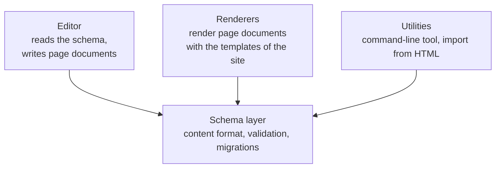

# Architecture

loomhelix-cms has three layers: the schema layer, the renderers, and the editor. Each layer is a separate set of
packages. You can use one layer without the other layers.

## Layers

| Layer        | Job                                                                                 | Depends on   |
| ------------ | ----------------------------------------------------------------------------------- | ------------ |
| Schema layer | Defines the content format. Validates page documents and applies migrations.        | Nothing      |
| Renderers    | Render page documents with the templates or the components of a site.               | Schema layer |
| Editor       | Lets a client edit page documents in a side panel, with a preview of the real page. | Schema layer |

Utilities are tools around the layers, for example a command-line tool and an import from HTML.

The editor does not use a renderer. The site renders the preview with its own renderer, and the bridge script
connects the preview to the editor. For this reason, the editor works with each stack.

## Terms

| Term           | Meaning                                                                                 |
| -------------- | --------------------------------------------------------------------------------------- |
| Content format | The rules for schemas, page documents, and migrations. Part 1 of the spec defines them. |
| Schema         | The JSON file that defines the page types and the block types of one site.              |
| Page document  | The JSON content of one page: the root block and the blocks in its slots.               |

[The spec](spec-v0.md) gives the other terms.

## Use one layer

| You use                         | Result                                                                  | Example                                                     |
| ------------------------------- | ----------------------------------------------------------------------- | ----------------------------------------------------------- |
| The schema layer                | Validation and migrations for blocks that you store already.            | A backend that applies migrations to all pages at a deploy. |
| The schema layer and a renderer | Rendering with block versions and a fallback for invalid blocks.        | An Astro site that renders blocks from its own database.    |
| The editor and your backend     | A visual editor that saves page documents through two endpoints.        | An admin page in a PHP back office.                         |
| All layers                      | The editor in the back office, and a renderer on the site.              | A site that a client edits.                                 |
| All layers through `createCms`  | The editor, the endpoints, the preview, and the pages from one handler. | A Node.js site with `@loomhelix-cms/node`.                  |

If your content has a different format, convert it to page documents before a renderer gets it. Then the conversion
function is the only code that knows both formats.

## Boundaries

These rules keep the layers separate:

- The schema layer does not use the DOM, the network, or a framework. As a result, it runs in browsers, in Node.js,
  and in workers. Its functions are pure: data in, data out. Only `loadDocumentSet` reads other documents, through a
  `read` function that the site gives.
- A renderer depends only on the schema layer and on its framework. It does not know the editor. Part 2 of the spec
  gives the rules for renderers.
- The editor depends on the schema layer, on a storage that the site gives, and on the preview. It does not know the
  framework of the site, and it does not talk to a database or to a fixed API.
- The editor SDK contains the state of the editor, the commands, the undo history, and the bridge client. The
  embedded editor uses the SDK. The SDK stays internal until its API is stable, because each public API is a promise
  to the users.

## Storage

The core does not keep documents. The site gives the editor a storage with `read`, `write`, and an optional `list`
(section 8 of the spec). The site decides where the documents go and who can change them, because each site has
its own database, login, and rules.

Adapters are optional packages for one stack. They are not part of the core, and a site can skip them:

- `createHttpStorage(apiUrl)` of the editor package calls the two HTTP endpoints of section 8.1.
- `createCms` of `@loomhelix-cms/node` gives these endpoints, a folder storage, the editor page, the preview, and
  the pages on Node.js.

## Specification and test cases

The content format is a specification, not only a library. For this reason, a port to a different language, for
example PHP or Python, can implement the same format. Before version 1, the specification gets two parts that a
program can check:

- JSON Schema files for the schema and the page document.
- Shared test cases. Each test case contains a schema, a page document, and the expected result of the load
  algorithm.

An implementation conforms to the specification when it passes all shared test cases.

## Packages

| Layer        | Package                       | Status            | Content                                                            |
| ------------ | ----------------------------- | ----------------- | ------------------------------------------------------------------ |
| Schema layer | `@loomhelix-cms/schema`       | Draft             | Schema reader, document loader, and migrations.                    |
| Renderers    | `@loomhelix-cms/render-html`  | Draft             | Rendering to HTML text with template functions, for Node.js sites. |
|              | `@loomhelix-cms/render-lit`   | Planned           | Rendering with Lit and web components.                             |
|              | `@loomhelix-cms/render-react` | Planned           | Rendering with React components.                                   |
|              | `@loomhelix-cms/render-vue`   | Planned           | Rendering with Vue components.                                     |
| Editor       | `@loomhelix-cms/editor`       | Draft             | The embedded editor: the `<lhcms-editor>` element.                 |
|              | `@loomhelix-cms/editor-sdk`   | Planned, internal | The state, the commands, the undo history, and the bridge client.  |
|              | `@loomhelix-cms/bridge`       | Draft             | The script for the preview page.                                   |
| Utilities    | `@loomhelix-cms/cli`          | Draft             | The `lhcms` command: `build`, `types`, and `template`.             |
|              | `@loomhelix-cms/import-html`  | Planned           | An import from legacy HTML into page documents.                    |
| Adapters     | `@loomhelix-cms/node`         | Draft, optional   | `createCms`: the HTTP endpoints, the editor page, and the preview. |

The templates of a PHP site with Twig are also a renderer. They need a PHP port of the schema layer for the load
algorithm. The PHP port comes after the first release.

Do not add a shared package for the renderers before two renderers contain the same logic. Then the shared package
`@loomhelix-cms/render` gets that logic.

## Release order

Each step gives a result that people can use:

1. The schema layer, with the specification and the shared test cases. After this step, developers can validate and
   migrate their blocks.
2. Two renderers: HTML and Lit. They show that the content format works with more than one stack.
3. The embedded editor and the bridge, on the internal SDK. After this step, clients can edit pages.

The command-line tool grows with steps 1 to 3. The import from HTML comes after step 3.
